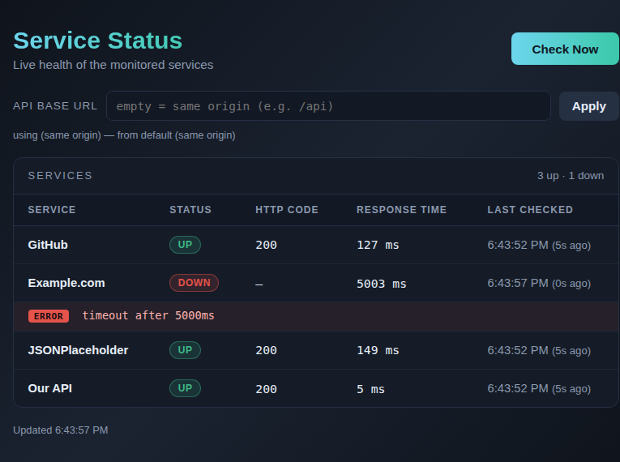
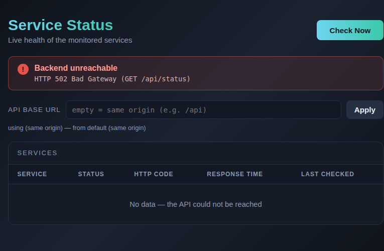

# Task 2 — Dashboard: how the browser reaches the API

Everything below was run and observed locally. Commands and output are copied
from the actual session, not from documentation.

## 0. The layout I am working with

```
public/          the dashboard (HTML/CSS/JS, no build step, no dependencies)
dev/             throwaway harness: stub backend, tests, nginx config, Dockerfile
```

The real backend (`src/server.js`, Task 1 / @vjkumar7797) is not merged yet, so
`dev/stub-backend.cjs` implements the same contract to have something to run:

| Endpoint    | Method | Purpose                                  |
|-------------|--------|------------------------------------------|
| `/health`   | GET    | `{"status":"ok"}`                        |
| `/api/status` | GET  | list of services + last check time       |
| `/api/check`  | POST | re-check every service, return the list  |

One service object:

```json
{"name":"GitHub","status":"UP","httpCode":200,"responseTimeMs":220,"error":null,"checkedAt":"2026-10-22T13:02:39.235Z"}
```

`error` is `null` when the service is up, and a message when it is down.

---

## 1. How does the browser reach the API?

The browser only ever talks HTTP to a **host:port on the machine the browser
runs on**. It knows nothing about containers.

The chain in the "page served by nginx" setup:

```
browser (host, 127.0.0.1:8080)
   │  1. GET /                     ─┐
   │  2. GET /api/status           ─┤ same origin → same host:port
   │  3. POST /api/check           ─┘
   ▼
host port 8080  ──(docker port publish)──►  nginx container :80
                                              │  serves /usr/share/nginx/html (the dashboard)
                                              │  location /api/  →  proxy_pass http://api:3000
                                              ▼
                                        api container :3000  (docker network "monitor-net")
```

Step by step, with the actual observations:

1. **The page is fetched from nginx.** `GET http://localhost:8080/` →
   `200 OK`, `Content-Type: text/html`. `localhost:8080` is the host port that
   Docker published; inside the container nginx is listening on `:80`.
2. **The dashboard asks for `/api/status` relative to its own origin.** Because
   the base URL is empty (same-origin default), the browser resolves it to
   `http://localhost:8080/api/status` — *not* to `http://localhost:3000`.
3. **nginx matches `location /api/` and reverse-proxies it** to
   `http://api:3000`, where `api` is a **docker network alias** resolved by
   docker's embedded DNS (`127.0.0.11`) inside `monitor-net`. The backend never
   sees a published port in this path — container → container traffic goes
   straight over the bridge network.
4. **The response comes back through nginx** and the browser renders the rows.

The browser's request never touches the API container's published port when
the page is served by nginx. The published port (`-p 3000:3000`) is only for
clients *outside* the docker network — i.e. curl from my shell, or a browser
pointing straight at the API.

### The same path when the backend serves the page

If the backend serves `public/` itself, the page and the API share one origin
(`http://localhost:3000`), so there is no proxy at all: the browser asks
`http://localhost:3000/api/status` and the backend answers directly. That is
the simplest setup and it is what `dev/stub-backend.cjs` does.

**Important consequence I hit while testing:** in that setup, if the backend
stops, the browser cannot even download the page — I got Chrome's
`chrome-error://chromewebdata/` page, not my banner, because there is no
JavaScript running to show a banner. The banner only works when the HTML comes
from somewhere that is still up (nginx, a CDN, a file). That is the whole
reason to serve the dashboard from a separate container.

---

## 2. Which port does the API use?

**3000**, and it comes from an environment variable so it can change:

```js
const PORT = Number(process.env.PORT || 3000);   // dev/stub-backend.cjs
```

The real backend (Task 1) does the same thing — its acceptance criteria say
`curl localhost:3000/health` returns `{"status":"ok"}`.

Three different "ports" are easy to confuse, so here they are:

| Port | Where it lives | What it is |
|------|----------------|------------|
| 3000 | inside the api container | the port the Node process listens on |
| 3000 | on the host | the published port (`-p 3000:3000`), for clients outside the docker network |
| 80   | inside the nginx container | nginx's listen port |
| 8080 | on the host | the published port for nginx (`-p 8080:80`) |

---

## 3. How does Docker expose that port?

Two separate mechanisms, and only one of them does anything:

**`EXPOSE 3000` in the Dockerfile — documentation only.** It records which
port the image expects. It does *not* open anything, on the host or anywhere
else. A container with `EXPOSE` and no `-p` is unreachable from the host:

```dockerfile
EXPOSE 3000
```

**`docker run -p 3000:3000` — this is the actual publish.** It creates a
port-forwarding rule on the host: `host:3000 → container:3000`.

```bash
docker run -d --name api --network monitor-net --network-alias api \
  -p 3000:3000 monitor-stub:latest
```

Observed:

```
$ docker ps
NAMES   IMAGE                 STATUS                    PORTS
api     monitor-stub:latest   Up (healthy)               0.0.0.0:3000->3000/tcp
web     nginx:alpine          Up                         0.0.0.0:8080->80/tcp
```

`0.0.0.0:3000->3000/tcp` means: everything that arrives at the host on port
3000 is forwarded to port 3000 of that container. `0.0.0.0` = all interfaces,
so the port is reachable from other machines on the LAN too. `127.0.0.1:3000:3000`
would bind to loopback only.

Three more things Docker does that matter here:

* **The container must listen on `0.0.0.0`, not `127.0.0.1`.** If the process
  binds to loopback *inside* the container, the port-forward lands on an
  interface nothing is listening on, and the connection is refused. My stub
  defaults to `HOST=0.0.0.0` for exactly this reason.
* **`EXPOSE` and `-p` are independent.** `EXPOSE 3000` + `-p 8080:3000` is
  perfectly fine; the numbers do not have to match. But `EXPOSE` with no `-p`
  means "not reachable from outside", and `-p` with no matching `EXPOSE` works
  too — `EXPOSE` is only a hint.
* **`HEALTHCHECK` is separate again.** My stub image has
  `HEALTHCHECK CMD wget -qO- http://127.0.0.1:3000/health` and docker reports
  the container as `Up (healthy)`. That health check runs *inside* the
  container, which is why it uses `127.0.0.1` — inside a container, localhost
  is the container itself.

For compose the same thing is written as:

```yaml
services:
  api:
    ports:
      - "3000:3000"
```

---

## 4. How does GitHub Actions build the app?

The workflow I added is `.github/workflows/dashboard.yml`. A GitHub Actions
workflow is a YAML file that runs **on a fresh runner VM** — each job gets its
own clean machine, so nothing I have locally exists there.

```yaml
jobs:
  test:
    runs-on: ubuntu-latest
    steps:
      - uses: actions/checkout@v4          # 1. get the code
      - uses: actions/setup-node@v4        # 2. install node 22
        with: { node-version: '22' }
      - run: node --test dev/              # 3. run the tests

  docker:
    runs-on: ubuntu-latest
    steps:
      - uses: actions/checkout@v4
      - run: docker build -f dev/Dockerfile.stub -t monitor-stub:${{ github.sha }} .
      - run: docker run -d --name api -p 3000:3000 monitor-stub:${{ github.sha }}
      - run: curl -sf http://localhost:3000/health     # smoke test
      - run: curl -sf http://localhost:3000/api/status
```

So "GitHub Actions builds the app" means literally: **check out the repo, run
`docker build` with the Dockerfile, tag the resulting image with the commit
SHA, then run that image and hit it with curl.** The image is built from the
Dockerfile the same way I built it by hand:

```bash
docker build -f dev/Dockerfile.stub -t monitor-stub:latest .
```

What each layer means in `dev/Dockerfile.stub`:

* `FROM node:22-alpine` — the base image (a prebuilt filesystem + node).
* `WORKDIR /app` — the working directory for the next commands.
* `COPY dev/stub-backend.cjs ./stub-backend.cjs` and `COPY public ./public` —
  copies the app files into the image. Nothing outside the build context is
  copied, and the files are copied into the *image*, not mounted at runtime.
* `ENV PORT=3000` / `ENV HOST=0.0.0.0` — baked-in defaults, overridable with
  `docker run -e`.
* `EXPOSE 3000` — the documented port (see above).
* `HEALTHCHECK` — how docker decides the container is healthy.
* `CMD ["node", "stub-backend.cjs"]` — the command run when the container starts.

Why an image at all, rather than running the source directly? The image is a
snapshot: it contains the exact files that were tested, with the exact
dependency versions, and it runs the same way on my machine, on the CI runner
and in production. `docker run` of that image *is* the smoke test — if the
image is broken, CI fails before anything is deployed.

The project-wide pipeline (test + build + push to ghcr.io on merge) is Task 3's
job and lands in `.github/workflows/ci.yml` / `release.yml`. Mine is scoped to
the dashboard so the two do not collide.

---

## 5. Serving the page from nginx — what broke, and how I fixed it

Setup used:

```bash
docker network create monitor-net

docker run -d --name api --network monitor-net --network-alias api \
  -p 3000:3000 monitor-stub:latest

docker run -d --name web --network monitor-net -p 8080:80 \
  -v "$PWD/dev/nginx/default.conf:/etc/nginx/conf.d/default.conf:ro" \
  -v "$PWD/public:/usr/share/nginx/html:ro" nginx:alpine
```

`dev/nginx/default.conf`:

```nginx
location /api/ {
    proxy_pass http://api:3000;      # no trailing slash: keep /api/status intact
    proxy_set_header Host $host;
}
```

### Break 1: `localhost` inside a container

My first instinct was `proxy_pass http://localhost:3000;`. Inside the nginx
container, `localhost` is **the nginx container itself** — not the API
container and not my host.

```
$ curl -o /dev/null -w "%{http_code}\n" http://localhost:8081/api/status
502

$ docker logs web-broken | tail -1
[error] 20#20: *1 connect() failed (111: Connection refused) while connecting
to upstream, ... upstream: "http://127.0.0.1:3000/api/status", host: "localhost:8081"
```

nginx tried to connect to *itself* on port 3000, where only nginx's own port
80 is open → `Connection refused` → nginx answers `502 Bad Gateway`.

**Fix:** use the container's network alias, `http://api:3000`. Docker's
embedded DNS (127.0.0.11) resolves `api` to the api container's IP on the
`monitor-net` network. The same trap applies to the backend's own self-check:
a service that points at `http://localhost:3000/health` works inside the
container but breaks the moment the API runs on the host.

### Break 2: CORS (cross-origin request blocked)

With the page served by nginx on `:8080` but the API base URL pointed straight
at the API on `:3000` (`http://localhost:8080/?api=http://localhost:3000`),
the browser refused the response:

```
[console/error] Access to fetch at 'http://localhost:3000/api/status' from
origin 'http://localhost:8080' has been blocked by CORS policy: No
'Access-Control-Allow-Origin' header is present on the requested resource.
! FAILED net::ERR_FAILED
```

The request *was* sent and the API *did* answer `200` — the browser threw the
response away because the page's origin (`localhost:8080`) differs from the
API's origin (`localhost:3000`) and the API did not allow it.

The nasty part: **the JavaScript only sees `Failed to fetch`.** The real
reason is only in the DevTools console, never in the error object. My banner
therefore says `Failed to fetch (GET http://localhost:3000/api/status)`, which
is honest but vague — the console has the truth.

**Fix — two ways, and I tried both:**

1. **Same origin (the right fix for this project):** let nginx proxy `/api/`
   to the backend, and leave the API base URL empty. Then the page and the API
   share an origin and the browser never applies CORS at all. This is the
   default configuration in `dev/nginx/default.conf`.
2. **Let the API opt in:** the stub sends
   `Access-Control-Allow-Origin: *` when started with `ALLOW_CORS=1`:

   ```bash
   docker run -d --name api --network monitor-net --network-alias api \
     -p 3000:3000 -e ALLOW_CORS=1 monitor-stub:latest
   ```

   ```bash
   $ curl -sD - -o /dev/null http://localhost:3000/api/status | grep -i access-control
   Access-Control-Allow-Origin: *
   Access-Control-Allow-Methods: GET, POST, OPTIONS
   ```

   With that header present the cross-origin fetch succeeds and the table
   renders normally.

Note the request itself was a "simple request": no custom headers and no
`Content-Type`, so the browser sent the POST directly with no preflight
`OPTIONS` round trip. Adding `Content-Type: application/json` would make it a
preflighted request, which needs the API to answer `OPTIONS` as well.

### Break 3: the API is down

With nginx still up and the API container stopped:

```
$ docker stop api
$ curl -o /dev/null -w "%{http_code}\n" http://localhost:8080/            # 200  (page still loads)
$ curl -o /dev/null -w "%{http_code}\n" http://localhost:8080/api/status  # 502  (nginx cannot reach the API)
```

In the browser: the page loads, the table shows
"No data — the API could not be reached", and the red banner appears with
`HTTP 502 Bad Gateway (GET /api/status)`. Not a blank page — that is the
"backend unreachable" requirement.

There are two different timings for the same outage, and the difference tells
you what happened:

```
$ docker exec web getent hosts api        # after the container is fully gone
(no DNS entry for api)

$ curl -o /dev/null -w "status=%{http_code} time=%{time_total}s\n" http://localhost:8080/api/status
status=502 time=14.290319s
```

* **Right after `docker stop`** the container's IP is still known to the docker
  DNS, so nginx connects, gets `Connection refused` and answers `502` straight
  away.
* **Once the container is gone from the network** the name `api` no longer
  resolves at all, so nginx's resolver retries and only gives up after ~14s
  with a `502`.

Both end in the same place in the UI, but the browser gave up first in the
second case: my dashboard has a 10 second timeout on the request, so the
banner reads `request timed out after 10000ms` instead of
`HTTP 502 Bad Gateway`. A page with no timeout would sit on a spinner
forever — which is why the `AbortController` in `public/app.js` exists.

---

## 6. The exact request the "Check Now" button sends

### curl -v (direct to the API)

```
$ curl -v -X POST http://localhost:3000/api/check
* Host localhost:3000 was resolved.
* IPv6: ::1
* IPv4: 127.0.0.1
* Connected to localhost (::1) port 3000
> POST /api/check HTTP/1.1
> Host: localhost:3000
> User-Agent: curl/8.5.0
> Accept: */*
>
< HTTP/1.1 200 OK
< Content-Type: application/json; charset=utf-8
< Content-Length: 591
< Cache-Control: no-store
<
{"services":[{"name":"GitHub","status":"UP","httpCode":200,"responseTimeMs":467,...
```

### curl -v (through nginx)

```
$ curl -v -X POST http://localhost:8080/api/check
* Connected to localhost (::1) port 8080
> POST /api/check HTTP/1.1
> Host: localhost:8080
>
< HTTP/1.1 200 OK
< Server: nginx/1.31.8
< Content-Type: application/json; charset=utf-8
<
{"services":[{"name":"GitHub","status":"UP","httpCode":200,"responseTimeMs":355,...
```

The browser sends the same thing. From the DevTools Network tab (captured over
the Chrome DevTools Protocol, `Network.requestWillBeSent` /
`Network.responseReceived`):

```
> POST http://localhost:8080/api/check
  request headers: {
    "sec-ch-ua-platform": "\"Linux\"",
    "Referer": "http://localhost:8080/",
    "User-Agent": "Mozilla/5.0 ... HeadlessChrome/154.0.0.0 ...",
    "sec-ch-ua": "\"Not A(Brand\";v=\"99\", \"Chromium\";v=\"154\"",
    "sec-ch-ua-mobile": "?0"
  }
< 200 OK application/json
= finished, 763 bytes
```

And the page load before it:

```
> GET http://localhost:8080/                 < 200 OK text/html
> GET http://localhost:8080/style.css        < 200 OK application/javascript (text/css)
> GET http://localhost:8080/app.js           < 200 OK application/javascript
> GET http://localhost:8080/api/status       < 200 OK application/json
```

Two things worth noticing in the browser's headers:

* there is **no `Content-Type`** — the POST has no body, so it stays a
  "simple request" and no CORS preflight is needed;
* there is **no `Authorization`** — the dashboard is an unauthenticated
  read-only view; anything else would need a token and would then trigger a
  preflight.

### The rendered table

```
Service          | Status | HTTP code | Response time | Last checked
GitHub           | UP     | 200       | 214 ms        | 6:37:36 PM (5s ago)
Example.com      | DOWN   | —         | 5003 ms       | 6:37:41 PM (0s ago)
ERROR timeout after 5000ms
JSONPlaceholder  | UP     | 200       | 223 ms        | 6:37:36 PM (5s ago)
Our API          | UP     | 200       | 1 ms          | 6:37:36 PM (5s ago)
```

The `ERROR timeout after 5000ms` line is the extra row rendered under a
service that could not be reached.



And with the API stopped:



---

## 7. How to reproduce all of this

```bash
# 1. the API (also serves the dashboard from the same origin)
docker build -f dev/Dockerfile.stub -t monitor-stub:latest .
docker run -d --name api --network monitor-net --network-alias api \
  -p 3000:3000 monitor-stub:latest

# 2. the dashboard in its own container
docker run -d --name web --network monitor-net -p 8080:80 \
  -v "$PWD/dev/nginx/default.conf:/etc/nginx/conf.d/default.conf:ro" \
  -v "$PWD/public:/usr/share/nginx/html:ro" nginx:alpine

# 3. look at it
open http://localhost:8080/            # page from nginx, API through the proxy
open http://localhost:3000/            # page from the backend itself

# 4. break it
docker stop api                        # -> banner "HTTP 502 Bad Gateway"
open "http://localhost:8080/?api=http://localhost:3000"   # -> CORS, unless ALLOW_CORS=1
```

Tests: `node --test dev/*.test.cjs`

> CI caught one thing on the first run: `node --test dev/` (a directory) works
> on Node 26 but not on Node 22, which tries to `require` the directory and
> fails with `Cannot find module .../dev`. Listing the files explicitly works
> on both, so that is what the workflow runs.
